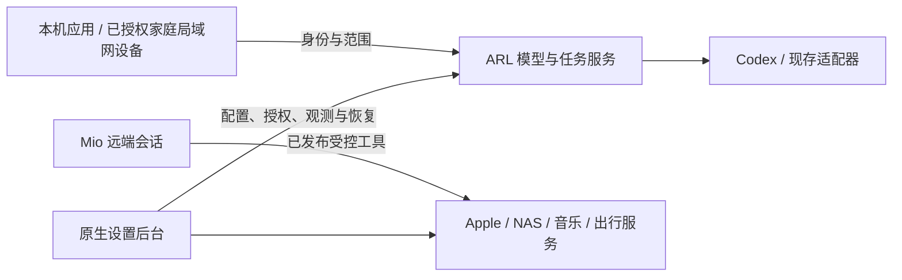

# ARL · Agent Runtime Layer

家中 Mac 的 Agent 与工具运行层。让本地应用和远端会话在真实身份、连接、权限与结果边界内使用能力。

交付单位是一个正式 ARL.app：包含后台运行时、原生管理面与必要包内隔离组件。用户不另装或启动辅助应用、插件或源码服务。后台负责身份、任务队列、模型路由与有界工具；管理面负责连接、登录、权限、状态和排错。模型路线当前仅 Codex。独立应用通过通用协议接入，不是固定产品依赖。

模型与推理能力面向本机应用及已授权的家庭局域网设备，不通过 Mio 隧道发布。Mio 继续提供 Apple、NAS、音乐、出行等已有受控服务。此边界不自动新增局域网监听、设备身份或权限，也不恢复历史已删除的 provider。

## 如何使用

**概览 → 连接 → 对应功能 → 核对结果。**

- 概览：后台状态、握手成功的应用、队列与负载。
- 连接：账户、网络硬盘、系统权限。设置就近完成。
- 提醒、信息、备忘：所选范围内的操作；首次授权与写入分别确认。
- 性能、记录、诊断：查用量、错误、模型和技术事实。

应用名称、通用图标、版本和请求能力来自经过身份校验的双向会话。静态配置、发现进程或旧 heartbeat 不会产生应用卡片。没有握手时显示空列表；读取失败、权限拒绝和效果未知都有明确状态。



## 从干净机器开始

让 Agent 按 [安装与排错](docs/AGENT-INSTALL.md) 执行。先检查，再准备隔离状态并运行真实元数据 RPC：

```sh
python3 -B script/bootstrap.py --check
python3 -B script/bootstrap.py --prepare --smoke
# 只有需要从源码构建原生包时：
python3 -B script/bootstrap.py --check --native
```

脚本不登录账户、不保存凭据、不创建隧道、不安装自启动服务。开发核心使用 Python 3.9+ 标准库，无第三方 Python 依赖；正式 App 的解释器在包内。原生构建要求 Apple Silicon、macOS 14+ 和 Swift 6 工具链。正式包已封装的音乐与 NAS 组件无需用户再次 npm/pip 安装。

**公开发布尚未就绪。** 当前原生构建仍依赖尚未公开的离线资源与维护者签名配置，干净克隆只能完成核心检查；不能把本机成功构建当作公开安装已闭合。公开资源、通用签名配置和发行许可证必须补齐。Mio 是可选边界，账号与隧道由使用者自己的平台交互配置；不会复用作者的组织、域名、隧道或 token。

## 当前能力与限制

| 能力 | 已有实现 | 实机边界 |
| --- | --- | --- |
| 运行时 | Socket RPC、持久队列、去重、取消、恢复、身份门 | 长期稳定性仍待验 |
| 应用连接 | 双向挑战/确认、登记代次、撤销、过期与旧响应隔离 | 生产调用方需消费新会话协议 |
| Codex | 有界文本/研究适配器与审查入口 | 各调用方授权和完整效果分别核验 |
| 网络硬盘 | 服务器登录、验证、共享枚举、明确目录授权 | 75验证登录/共享；目录和读取待验 |
| 提醒 | [单条提交、原生范围确认及独立结果记录](docs/product/REMINDERS-TASKS.md) | 82只读入口已验；真实保存和云同步待验 |
| 信息/备忘 | 范围、系统权限与独立结果核对 | 真实业务尚待验；不读取通讯录 |
| Mio 音乐 | 官方登录、读取、写入回执与恢复链路 | 本轮不重新执行真实音乐写入 |

本地模型扩展、采购 MVP、一键部署和任意宿主执行继续暂停。界面调整不代表这些业务已接通。

## 构建与验证

正式构建入口是 `build.sh` / `Build.command`。输入由 recipe 和离线清单固定，缺失即停止；默认只构建签名候选，不安装、启动或发布。

```sh
./build.sh --check --build-only --build-number <下一版本>
./build.sh --build-number <下一版本>
python3 -B -m unittest tests.test_app_connections tests.test_control tests.test_identity -q
```

候选、缓存与本机审计放在 ignored `build/`。升级前核对当前安装版本和 authority，完成独立审查；保留旧包与状态，不 reset 用户更改。

## 权限与恢复

宿主登记身份与 policy，调用方不能通过 JSON 自报 owner、路径、shell、凭据或 provider 扩权。握手只协商请求能力与现有授权的交集，不能新增 grant。系统权限、账号登录、业务连接和最终效果分别确认。

状态目录仅当前用户访问。任务输入和结果可能含私有内容；文件权限不等于加密。效果未知时保留记录与 `needs_review`，不自动重放外部写入；取消也不保证撤销已经发生的效果。账号与密钥只在原生交互中录入，不写进源码或命令参数。

## 开源准备

[统一应用边界](docs/product/UNIFIED-APP.md) · [发布隐私边界](docs/OPEN-SOURCE-READINESS.md) 记录当前阻断；[重构与 TODO](docs/product/REFACTOR-20261014.md) 区分已验证、待实机验证、待开发与暂停项。

```sh
python3 -B script/privacy_audit.py --history --output build/privacy-audit.json
```

审计只输出类型和路径；覆盖 tracked 文件及可达 Git 历史。ignored 本地状态、Keychain 和私人正文不属于发布内容，也不由脚本读取。命中时退出 2；删除工作树条目不能清理历史。未经专项确认不重写历史、不 force push、不转公开。

服务适配以忠于供应方请求与业务结果为原则；原始业务记录与 ARL 来源、分页、缓存和诊断分层，认证信封隔离。网易云的兼容与分页边界见[音乐透明适配](docs/product/NETEASE-TRANSPARENT-SEARCH.md)，高德/飞猪见[旅行透明适配](docs/product/TRAVEL-TRANSPARENT-READS.md)。

## 协议与代码

[会话接入](docs/APP-SESSIONS.md) · [RPC 协议](docs/PROTOCOL.md) · [控制面](docs/CONTROL-API.md) · [构建](docs/BUILD.zh-CN.md)

`arl/` 为运行时，`macOS/ARLControl/` 为管理面，`apple/` 为原生 helper，`script/` 和 `tests/` 为构建与验证。历史产品集成仍保留兼容代码，公开拆分前不能作为通用产品依赖或分发清单。


### 开源前源码检查

本轮修复及验证范围见 [OPEN-SOURCE-REVIEW.md](OPEN-SOURCE-REVIEW.md)。macOS 上可直接从源码编译完整 SDK 和 Control，无需作者的签名、账号或离线资源壳：

```sh
python3 -B script/check_native_source.py
```

该命令只编译，不签名、安装或启动。正式打包仍需自行准备依赖与签名配置；历史部署证据和本地状态不属于公共源码分发。

许可证待维护者确认；[LICENSE.proposed](LICENSE.proposed) 是供审阅的 MIT 草案。
