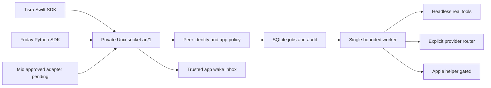

# 架构和执行边界

一个无 UI 用户进程包含本地 RPC、持久调度和单个执行 worker；不是一组微服务。文件以能力职责拆分：`contracts` 严格 schema / tool / provider / app policy，`storage` 事务与审计，`service` RPC 与队列，`lifecycle` 私有文件 / peer UID / 单实例，`identity` 可选受控进程验证，`wake` 注册 ID inbox，`providers` 本地 HTTP / 路由，`apple` helper transport，`travel` 兼容 schema，`client` SDK。

### 生命周期

1. 客户端先发现固定 home 的 socket；ready RPC 有独立版本校验。
2. socket 不在 / 已断连且用户未停用时，SDK 仅调用本地预组装的 RuntimeLauncher；它的 interpreter、module 和工作目录来自安装代码，不接受 RPC 任意参数。客户端首次连接最多启动一次，指数退避+jitter 等 ready。
3. 服务在获得 lifetime flock 后校验 disabled；绑定 socket 后 live 先可见，再做恢复，之后 ready。第二实例不改 endpoint。僵尸 socket 由锁拥有者清理，不用 `kill` 查找并结束未知 PID。
4. 崩溃连接恢复后 submit 重用相同 key / payload；结果可按 id 查询。
5. 主动 stop 先落盘 disabled，再停服务，客户端不自行撤销停用。SIGTERM 不持久停用。
6. ARL 向 app 发 wake 只认注册 app ID，持久 inbox 最多每 app 64 条，可附加 host 预组装 callback。未知 ID、命令、路径拒绝。默认不打开任何 GUI app；离线 app 启动属于可信 host adapter，不能把 inbox delivery 等同 GUI 已启动。inbox poll 是消费并删除，回调失败不会得到 exactly-once 保证。

### 队列与恢复

`queued → running → succeeded / failed / cancelled / needs_unlock / needs_review`。queued / running / needs_unlock 占 pending 预算。事务保存 owner、key、摘要、tool、args、idempotent、attempts、cancel flag、next_at、result、error、created / updated。数据库 schema v3 (source; installed core v2)，额外持久保存 requires_identity、permissions、tool_contract digest、identity_authorized；v1 保守迁移为未知私有/未验证，不能自动降级权限。未来版本拒绝打开，不覆盖用户数据。

同 owner + key + 相同摘要返回同 job；同 key 不同请求拒绝。幂等范围是逻辑任务提交，不是外部系统 exactly-once 承诺。running 在进程恢复时：非幂等一律 needs_review；幂等未取消且 attempts<3 重新 queued；取消变 cancelled；已达 3 次变 failed。恢复时先检查当前工具存在及精确 contract digest；queued/running/needs_unlock 的工具删除或属性漂移均进入 needs_review，不重放。执行前再检查当前 app 白名单、持久身份授权与模型 policy。私有结果查询与去重检查持久权限及当前工具要求，描述删除/降级不能绕过原权限。

只有 idempotent + 明确 transient / provider_unavailable 错误有限重试，初始 backoff 0.2s、之后 0.4s，上限三次执行；永久未知/权限/输入错误不重试。无穷重试没有实现。自定义 adapter 必须给网络、UI和子进程设 deadline，不能阻塞 worker 任意时长。

`cancel` 是请求：running 保持 running 直到执行者确认，不能宣称外部副作用已撤销。幂等工具协作取消；非幂等执行中取消/崩溃/未知异常进入 needs_review，禁止自动恢复。迟到的 cancel 不把已成功外部操作误报 cancelled。非幂等 handler 抛 needs_unlock 也转 needs_review，避免不知道是否已经写入时自动重放。未来写操作应独立实现无副作用 preflight、稳定对象版本核对和写后确认。

needs_unlock 不轮询或自动叫醒 UI，需人工解决后由原 owner 显式 resume；队列继续运行其他工具。权限缺失返回明确 error，不把超时推断为锁屏。当前 Apple 两项是只读；没有 UI 自动化队列或原生锁屏检测。单 worker 保守限制并发内存，模型推理最长网络等待 30 秒，可能让排队工具延迟；真正模型 worker 进程隔离/优先级是后续纯代码改进，不声称已实现。

### 预算与模型

默认每逻辑 app 待办64、累积新任务1000、输出256 token、prompt≤1024 UTF-8字节；服务检查 schema 最大512 token再检查app256限额。不声称精确 tokenizer 计费。持久调用预算在 submit 同一事务中增加，失败/取消不退回，dedupe 不重复扣。没有 RPC 重置预算；预算重置策略待部署审批。mock 标注 simulated；所有真实 provider 必须显式名+模型名。provider名字只是路由，不是付费授权。

默认 Ollama/Laya推理禁用；只读发现不加载模型。Ollama仅调用固定 `/api/tags` 与 `/api/generate`，模型必须在tags，`stream=false`、`num_ctx=2048`、输出cap、`keep_alive=0`；没有pull。Laya调用Friday现有`/health`和`/classify`，结果仅是label/confidence，不直接执行家居动作。固定loopback，不读环境代理，重定向拒绝，不读Key，不传文件或shell。Codex/Jev付费路由始终禁用，缺少scope与可靠成本预算的情况下不启动app-server或自动上传。

### 审计和权限

审计上限10000元数据行，不记录输入/结果/模型正文/供应方异常。job结果与输入仍在私有SQLite，部署前必须决定留存期和加密/敏感payload策略；自动删幂等记录会改变重复提交语义，当前不做。默认同UID逻辑app隔离不具备签名身份安全；敏感能力额外需要实际transport验证。注册verifier已实测，但尚未接入真实apps或生产helper权限，不能仅打开一个flag宣称生产安全。

RPC整体读取deadline为5秒，最多32个连接；handler关闭完成后才关SQLite。HTTP采用短命worker的整体deadline，到期kill+wait，不能由慢速滴流续期；没有隔离外部模型服务进程。shutdown超过grace仍有执行worker时，继续保有DB/socket/flock及closed=false，禁止另一个实例提前占用。

身份核验在RPC接受点线性化，revoke与generation复核受同一锁协调；已接受任务拥有持久窄授权，撤销不能追回已发生动作，host须另cancel/移除policy。ControlledSupervisor只启动固定审查manifest，核验source hash与PID/出生时间，不把shared解释器当产品身份。SignedPeerVerifier使用内核LOCAL_PEERTOKEN与Swift Security动态guest检查，要求cdhash pin或identifier+Apple anchor+Team ID完整约束；生产签名/安装未部署。

已安装0.1.1中，独立settings仅health/ready/overview允许同UID未验证公共元数据读取；方法白名单在没有verifier时仍生效。没有任务对象/正文/owner分组；能力授权未查时标authorization_not_checked。旧schema见SETTINGS-API.md。源码下一版保留旧overview，增加schema2只读settings.snapshot/logs/logs_export，精确contract见CONTROL-API.md；公开脱敏元数据仍不授予身份或任务权限。

### 第一部署与应用职责

arl.host 是独立metadata-only生产组合，其他app空grant/零预算；execute_jobs=false时不recover/claim历史工作。通用arl serve保留开发语义，不用作生产入口。版本SHA选择、当前用户LaunchAgent和安装/卸载/回滚见deployment/README.md；首个metadata-only版本已批准安装，真实launchd/service-only验收见DEPLOYMENT-ACCEPTANCE.md；下一版控制面不自动部署。

产品按本地Agent、云端Bot能力与跨域管理面组织。HA endpoint/认证/设备映射/规则由Friday拥有；ARL只消费Friday授出的有类型、有范围家庭状态能力，不重复HA配置或绕过其action policy。NAS也跟随所属app责任；管理页的发现与配置展示不产生访问授权。新增资源指标、外部token UI、Apple/iMessage/平台能力不属于本部署包范围。

源码控制面使用三个小模块：control的host-only登记/状态、metrics的延迟采样、diagnostics的固定字段环形日志。注册描述与真实transport验证分开；只有已登记且经过verifier的heartbeat更新连接证据。ControlledSupervisor可在已批准源码pin和内核登记后绑定描述与资源，受控进程死亡/实际verifier撤销/source漂移使登记失效。公开API不能提交PID、图标路径、版本、凭据或注册请求。时间是证据的原始采样时间，catalog不是模型loaded状态，shared process资源只计一次。

系统CPU/压力/swap与进程RSS不是任务正文；它们依旧只经当前用户私有socket提供。进程仅允许宿主控制集合，UID/出生时间在采样前后复核，不扫描所有应用或返回argv/env。日志仅固定事件、枚举code、已知app ID，当前进程最多1024条/24h、export64KiB；不读取供应方错误文本或旧任意日志。Apple是逐operation元数据，Notes/iMessage未实现不伪装needs_permission；凭据仅不解析的alias/fixture生命周期，未调用Keychain；HA/NAS只保留Friday所有权。

### One Mio tunnel extension (2026-10-01)

The same tunnel/plugin is the extensible capability entrypoint. Existing13 read tools are retained; the independent weather14th candidate has source and26 tests, without a generic gateway rewrite. Module discovery/schema versions/per-action read-write-send-actuate gates/readiness/errors/Friday actuation receipts are in [MIO-GATEWAY-CONTRACT.md](MIO-GATEWAY-CONTRACT.md). Exact weather publication delta: integrations/mio_weather/README.md and deployment-delta.json. HA/NAS remain Friday/owning-app responsibilities. Mio→ARL→Friday light control is not connected. Local tunnel health-ready is not provider authorization or confirmed device state. UI/client remain frozen and installed v2 is unchanged.

2026-10-01 source scheduling increment uses Store schema3; installed0.1.1-f12148172f69d4ab retains its immutable schema2 core. Single-event Calendar host has a separate fixed state home/controlled signed caller and no login agent. Codex typed text tool is opt-in, lacks upstream token hard cap and is not a Responses research provider.
