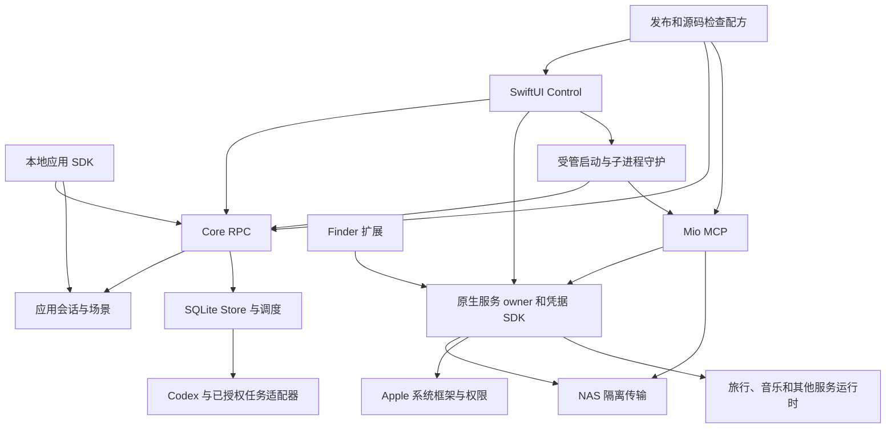

# ARL 架构地图

由发布配方和实际入口判定生产归属。验证命令和阶段记录见[进度](PROGRESS.md)，仍需验证的兼容边界见[任务池](BACKLOG.md)。

## 运行时和分发

| 边界 | 入口和拥有者 | 对外契约 |
| --- | --- | --- |
| 正式 App | `macOS/ARLControl/App/ARLControlApp.swift`；`ManagedLaunch` 与 `BundledRuntimeOwner` | 一个 App 内管理 Core 和包内 helper。Mio 依配方选配，正常退出、停用和安装维护影响受管子进程拉起 |
| 本地 Core | `script/bundled_runtime_entry.py` → `arl.host` → `arl.service.Runtime` | 本地 Unix socket `arl/1`；元数据、任务、应用会话。兼容组合按批准的宿主和产品范围装配 |
| 应用 SDK | `arl.client.Client`、`arl.application_session.ApplicationSession`、`integrations/tisra` 中的现有 Swift SDK | [应用接入](../APPLICATION-PLATFORM.md)、[应用会话](../APP-SESSIONS.md)、[RPC](../PROTOCOL.md)。挑战、确认、心跳与队列回执 |
| 原生管理面 | `RuntimeStore` → `SettingsService` 和各服务控制器 | [控制 API](../CONTROL-API.md)的版本化快照、日志与诊断；授权及写操作通过对应 owner |
| Mio | `integrations/mio_apple`、`script/mio_native_recipe.json`、`docs/mio-tools.json` | [Mio 工具契约](../MIO-GATEWAY-CONTRACT.md)。OS 互动与凭据留在本机 owner；远端只有已发布的有限工具 |
| 凭据和内置服务 | `integrations/credentials_login/Module`、`integrations/credential_read_owner`、Control 的 `CredentialVault` | Native owner 通过已验身份和范围签发访问；SDK、Mio 与后端传输各自遵守进程边界 |
| NAS | `macOS/ARLControl/NASSettings`、`integrations/nas`、Finder 扩展、`arl_nas_*` | [NAS 范围契约](../NAS-ACCESS-CONTRACT.md)，以及由各入口保留的删除、移动、文档和附件传输回执 |
| 发布 | `build.sh` → `script/build_release.py`；`script/release_recipe.json` 与分组件配方 | 配方明确源文件、签名、离线输入和密封摘要；安装事务负责切换、回读、回滚 |
| 公开源码 | `script/export_public_source.py` 和 `script/export_public_core.py` | 前者导出供审查的源码快照；后者生成零授权 Core 导入闭包。两种交付面各有隐私和装配边界 |

箭头指向调用或依赖方向。仓库级组图包含进程边界和源码组，Python 运行时的逐模块静态边可用 `python3 -B script/check_architecture.py --graph` 重建。Swift 源文件归属以实际编译组为准，Control 内部目录为职责分区。

## 模块与维护边界

| 源码组 | 职责和契约位置 |
| --- | --- |
| `arl/contracts`、`wire`、`lifecycle`、`identity`、`supervisor` | RPC 基础类型、帧解析、私有目录、peer 身份与进程由谁持有。业务能力依赖这些基础约束 |
| `arl/app_connections`、`application_contract`、`application_platform`、`application_models`、`control` | 会话、已授权交集、SDK 场景和任务契约、模型请求、应用注册表和元数据投影 |
| `arl/storage`、`scheduling`、`priority`、`priority_host` | 持久任务和公平性；已审查兼容路由另有优先级权威和准入，各自保留现有语义 |
| `arl/codex_*`、`research*`、`responses_*` | 模型列表、档位设置、Codex app-server 和研究 API。选材、上传、来源与结果校验按各自版本契约 |
| `arl/overview`、`metrics`、`diagnostics`、`runtime_description`、`modules`、`service_connections` | 读取运行观测、脱敏诊断和连接目录。持久化与快照格式在控制 API 约束内演进 |
| `arl/host`、`compat_host`、`private_compat`、`extension_contracts` | Core 装配和可选的本机兼容能力。账户路径归 `lifecycle`，peer 组合归 `identity`，设置元数据权限归 `control`。零授权 Core 的闭包由打包测试验证 |
| `arl/service_deployment`、`arl/install_*` | 前者拥有规划和服务门户元数据，受管安装拥有实际更新事务 |
| `macOS/ARLControl` | App/窗口 → Views → 可观察状态与 feature controllers → 服务或 RPC；`Models` 拥有快照解码与显示状态转换 |
| `integrations/credentials_login`、`credential_read_owner`、`service_runtime`、`mio_music` | Keychain 交互、已批准 read owner、受控运行时边与音乐素材/部署契约 |
| `apple`、`integrations/apple_calendar`、`calendar_native_setup`、`apple_permissions`、`apple_review` | EventKit helper、日历设置、系统授权观测和审核凭据。旧诊断入口按配方与历史证据核对用途 |
| `integrations/apple_notes`、`apple_notes_host`、`notes_permission_v2`、`apple_reminders`、`reminders_v3`、`imessage` | Apple 业务 owner、权限路由、历史版本接入和受审查的操作。Native 配方精确选择生效源码 |
| `integrations/mio_apple`、`mio_status` | MCP 工具发布、调用转发、状态和历史状态/天气交付 |
| `integrations/nas`、`nas_codex_v2_20261024`、`arl_nas_credential`、`arl_nas_upload_new`、`arl_nas_ui_composition` | SMB 会话、凭据和目录授权、文件处理、上传来源/日志和外部 NAS 模型路由。包内 NAS Python 与 Core Python 为不同进程 |
| `integrations/tisra`、`friday`、`codex`、`arl/tisra_capture_*`、`arl/friday_*` | 外部调用方、签名与 manifest 约束、Capture、研究和审核后的家居规划；升级需各自外部夹具 |
| `integrations/moments`、`macOS/ARLControl/Moments` | 私有归档、附件队列及 NAS 备份，保留本机与远端结果的独立证据 |
| `integrations/runtime_logging`、`script`、`tests`、`examples`、`vendor`、`.github` | 连接日志契约、发布与测试清单、调用例、离线依赖锁和 CI |

## 状态和规则归属

| 状态／规则 | 写入权威 | 读取或投影 |
| --- | --- | --- |
| 安装根、运行实例、停用与维护 | macOS 受管安装与 `arl.install_transaction`；Core 对运行实例持有 flock | Native supervisor、Core 启动入口、SDK ready |
| 连接会话、绑定代次、有效期 | `AppRegistry` 与 `AppConnections` 持同一 registry lock 更新；OS peer 由 verifier 核验 | SDK 心跳、控制快照、场景任务和模型协商 |
| 提交意图、任务、幂等键、调度计数 | `ApplicationPlatform` 负责校验会话与解析套餐。`Store` 持有 SQLite、原 v4 表、锁和原子提交 | RPC get/cancel、Overview/Diagnostics、恢复 worker |
| 模型列表、五档套餐、并行度 | Codex app-server 提供目录，`codex_execution_options` 定义套餐 ID 和默认值，`PackageRegistry` 与原生设置读写同一配置。`CodexModelPackage` 的 ID、顺序和默认显示名由跨语言测试验证 | 任务接纳时固定参数，设置和首页投影实际状态。并行度采用最近一次通过校验的配置 |
| 身份、工具名单、配额、应用配置 | 内核 UID/进程身份、已审核的 `AppPolicy` 和实际 host 组合；凭据在本机 Keychain owner | Registry 和 RPC 只协商交集；工具再次校验相应 capability |
| Apple 授权、默认写入位置、效果 | 系统权限由 OS 决定；对应 owner 持设置和写入回执 | Control 分别展示权限、连接和结果；默认写入位置与读取范围分离 |
| NAS server、目录、SMB session、文件变更回执 | Native credential owner、设置及 NAS runtime；Finder/Mio 调用按目录和凭据代次核验 | UI 只能显示当前连接证据并读回操作回执 |
| 日志、指标、连接观测 | Core `Diagnostics`、原生 owner 和对应运行时分别写脱敏诊断。采样由服务负责 | `SettingsService` 负责日志 RPC 和解码，`RuntimeStore` 与日志视图持有分页和显示状态 |
| 控件几何、颜色、动效、无障碍 | [DESIGN.md](../../DESIGN.md) 和 Control 的 `EditorialStyle`、共享组件 | 设置、服务卡与状态；具体业务只提供状态与文案 |
| 打包范围、工具发布、测试范围 | `release_recipe.json`、`mio_native_recipe.json`、`core_runtime_sources.json`、`docs/mio-tools.json`、`test_profiles.json` 按边界各自持有 | 构建、导出、签名校验、测试计划和 CI。构建根由 `local_build_area` 推导，包内源码指纹和启动校验共用 `arl/source_fingerprint.py` |

## 技术栈

| 层 | 现有方案 |
| --- | --- |
| Core/SDK | Python 3.9+ 标准库、SQLite、Unix socket RPC、`unittest` |
| App / 管理面 | Swift 6、SwiftUI、AppKit、Observation、Security、EventKit、PDFKit、Vision、FinderSync |
| 内置能力 | Swift owners、隔离的 NAS/Python、离线 Node 音乐 bridge；生产输入由 recipe 与 lock 精确选择 |
| 状态交换 | JSON/JSONL 与有界帧、版本化配置/回执、SQLite 事务、Keychain、包签名与哈希 |
| 工具链 | 调用 `swiftc` 的配方、Shell / Python 构建、GitHub Actions portable 与 macOS native、隔离测试 profile |

每批沿着可验证的调用边界推进，先固定目前的入参、回执、权限和恢复行为。把规则迁到持有该业务事实的模块，同时迁移调用方并删除等价实现；旧版 wire、持久数据和已部署的其他消费者由可复现证据决定保留范围。对接口新增的每个参数和类型做删除测试，只有封装了调用者本来必须理解的细节才保留。设计原则参见 [A Philosophy of Software Design](https://web.stanford.edu/~ouster/cgi-bin/book.php)。
