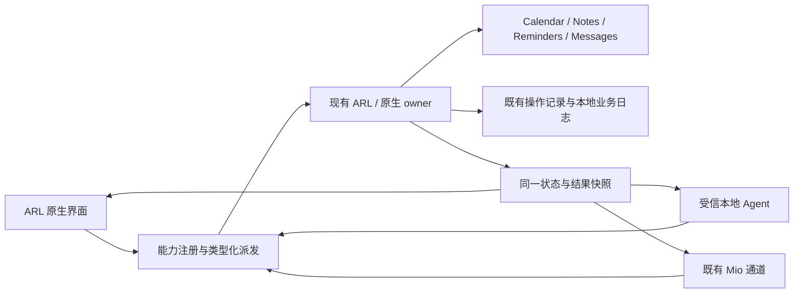

# Apple 共用执行与自动接入 · 2026-10-19

配套 [统一交付表](ARL-DELIVERY-20261019.md)。本页是批准开发后的实施方案；当前87音乐验证冻结期间只写文档，尚未改Apple生产源码、构建配方或安装。

## 产品行为

1. **打开即有状态**：启动自动查询真实owner的权限；从后台返回、唤醒和相关应用状态变化时合并刷新。Calendar的EventKit授权、Notes/Messages Automation、Reminders既有helper状态都只用无弹窗查询，绝不从自动刷新调用request。
2. **不要求每次先点检查**：正常情况下显示当前所选账户/目录/列表和主要业务表单。已有选择作为偏好恢复，操作前内部复核真实ID/所属关系；不把每次启动当成第一次设置。
3. **一个当前主入口**：未授权显示“连接授权”；已拒绝/撤销显示“系统设置”；缺范围显示“选择目录/列表”。授权和范围齐备后主按钮直接“创建/保存/发送”。检查、核对和接线术语不再占据正常用户流程，详情/全局刷新可用于排错。
4. **不让一次抖动清空状态**：保存最后一次可靠状态、观察时间、当前刷新/失联原因。短暂查询失败标为“最近状态，正在重试”，不改写成未授权；确定撤销/目标失效/断开才更新相应事实。最近证据用于展示，业务执行仍即时复核。
5. **后台不碰正文**：自动状态检查不读消息/笔记正文、不扫描账户内容、不创建目标、不打开Notes/Messages、不弹系统权限。元数据目录/账户列表只在需要显示/选择时有界获取；正文与消息内容由具体业务请求或已明示的接收范围驱动。
6. **表单就是本次意图**：Notes、Reminders和发送表单展示确切目标及完整内容，一次业务按钮冻结目标/参数和operation ID，内部串行校验后执行。重复确认同一意图不会重复效果；未知保留原记录，不换ID重试。新系统权限、第一次新范围或真实歧义才需要用户处理。

## 一条执行链

- 保留现有ARL签名主进程、包内owner socket与Mio身份；增加类型化能力与消费接线，不另起通用执行daemon、第二个queue或辅助App。
- UI与Agent共享后端。UI的前台ticket不伪装远端授权；远端沿已有可信IPC身份/范围进入同一执行服务，不能从JSON接受伪造owner/grant、任意AppleEvent或脚本。
- 原生 effect 持有的journal/去重边界继续有效，旧Notes/Messages一次记录、Reminder unknown记录不删不重置。新增业务复用已有记录机制，代码可收敛但不把不同历史语义强行合并成一份空记录。
- 旧Core apple_apps/不存在的apple_permissions RPC不再是新Apple主状态源。状态由effect owner生成，UI/Agent/Mio只投影同一快照；兼容数据留在技术详情，不能覆盖当前事实。

## 首批自动刷新实现

新增一个轻量Apple状态模型/协调器，挂到现有RuntimeStore刷新生命周期。每项记录分开保存permission、connection、selected-scope、last business result、observedAt、refresh error/in-flight；禁止把它们压成一个容易误导的ready。

调度初值采用：启动一次；前台常规30秒、后台120秒；激活/唤醒合并一次，2秒内重复触发合并；暂时失败按5/15/30/60/120秒退避，成功恢复正常周期。具体值可按实际UI与系统负载调整，不为状态每5秒重复构造EventKit或spawn多次helper。退出和取消停止新探测，旧代次结果不覆盖新owner。相同Reminder snapshot一次获取后供专页与权限摘要复用，取消当前多次重复读取。

Notes/Messages静默权限探测必须独立于当前需要目标应用已运行的AppleDirectSession业务构造；仅查询Automation授权，ask=false，不发送业务事件。若系统不能在该条件下给明确结果，保留最近事实并给具体原因，不为“取个状态”启动系统App或申请权限。Calendar使用实际主App状态；Reminder使用既有稳定helper身份的无提示入口，不能由主App的EventKit状态冒充helper授权。

首次申请仍只能来自明确前台连接动作。后台看到notDetermined/denied时只更新一个入口，不循环申请。已授权状态下“连接授权”不出现，也不把普通窗口打开映射到request。

## 稳定身份与升级

- 主App维持正式bundle ID、安装路径、既有开发签名主体/稳定requirement与必要entitlements。构建不能临时改ad-hoc、另造新bundleID或用新辅助App躲授权。
- 既有Reminder helper保持同一身份；Calendar新执行优先放实际已授权的主App，与其权限控制器同owner。旧Mio Calendar helper不继续提供另一份主权限/创建真相。
- 对“升级后权限又没了”，先比较新旧签名主体、requirement、bundle路径、entitlements/usage descriptions与当前真实TCC结果，区分身份变化和UI unknown初值。不得重置TCC、删授权或强迫重授权来消除显示问题。
- 最近权限缓存只绑定稳定owner身份用于展示；grant/业务scope/一次效果记录不是缓存绿灯，执行前仍检查当前授权及目标。

## 各原生业务的复用点

| 业务 | 复用 | 新增接线/行为 |
|---|---|---|
| Calendar | 主App CalendarPermissionController、现有EventKit/一次效果思路与journal | 同owner的创建与目标编辑服务。编辑所需读取/定位授权明确声明；已有create权限可独立可用，不因编辑未授权全部变红。不要将旧helper授权当主Appgrant。 |
| Notes | NotesDirectBackend的目录、搜索、read/create；当前controller目标复核与一次记录 | 静默权限/恢复范围；普通纯文本update的明确revision检查及回读。共享/加密/附件/富文本不支持时给原因，不整篇破坏性覆盖。 |
| Reminders | 包内v3 owner、ARLRemindersCore/EventKit、现有task及operation journal | 一般typed operation消费现有list/item/patch/date/recurrence/alert/complete，UI一次表单自动完成内部准备和核验；旧unknown smoke不触碰。 |
| Messages发送 | 现有DirectBackend accounts/unique participant/deliver与journal | 恢复用户选择的sender偏好，校验失败再引导选择；发送按钮内部核对邮箱，避免“查账户→选账户→核对→再发”的重复操作。只接受明确目标，不猜收件人。 |
| Messages接收 | 已存在候选receiver的查询/游标/清理语义，先核源码闭包 | 在现有ARL owner内组合受限新消息读取与Agent交付，持久游标防历史回放。若旧资源不可复用，先收敛唯一替代方案，不能再并列第三套收发宿主。所需FDA/范围集中说明。 |

本地GUI Agent可以使用现有界面，但这不能代替程序化消费者交付；反过来，Mio缺入口也不表示本机UI不存在能力。正式交付需UI与程序化入口都实测同一backend。

## 原始业务日志

使用r4收口后的共同日志接口，新增Apple/NAS/Codex能力接同一格式：operation/request ID、caller类别、能力、确切业务参数、原始业务结果/错误与阶段时间、是否开始效果/结果是否确定。本地完整保存至少7天；认证信封、密码/token、认证头始终排除。日志保存在用户私有运行目录，不进docs/Git/公开包，也不自动上传。管理面默认显示摘要，通过同一记录定位raw；不为了日志另发一遍业务。各效果的一次性记录仍负责防重放，raw日志不替代它。

## 精确路径所有权

### 已确认可写（当前窗口）

- `docs/product/ARL-DELIVERY-20261019.md`
- `docs/product/APPLE-EXECUTION-20261019.md`
- 自己的 ignored `build/audit/capability-truth-20261019.noindex/`

### 冻结与待释放

网易云r4的20项source-pins以writer的最终清单为准，不能用git diff列表冒充完整pin集合。所有生产源码与构建配方当前冻结，安装权归该writer。下列接缝已确认与其工作重叠或是发布公共面，释放前本任务不改：

- `integrations/credential_read_owner/OwnerReadWire.swift`
- `integrations/mio_apple/MioReadOwnerAdapter.swift`
- `macOS/ARLControl/Services/CredentialReadOwnerServer.swift`
- `integrations/credentials_login/Module/Sources/ARLCredentialOnboarding/CredentialOnboarding.swift`
- 音乐合约/运行时/journal/netease bridge及其测试
- `script/mio_native_recipe.json`、`script/release_recipe.json`、`script/build_release.py`、`script/build_incremental.py`、签名/安装与运行绑定

### Apple主线释放后的首批写集（拟保留给本任务）

仅先关闭自动刷新与重复检查体验，不把所有业务同时塞进首个补丁：

- 新增 `macOS/ARLControl/Models/AppleConnectionState.swift`
- 新增 `macOS/ARLControl/Services/AppleStatusCoordinator.swift`
- 修改 `macOS/ARLControl/Services/AppleDirectEvents.swift`
- 修改 `macOS/ARLControl/Services/NotesDirectController.swift`
- 修改 `macOS/ARLControl/Services/MessagesDirectController.swift`
- 修改 `macOS/ARLControl/Services/CalendarPermissionController.swift`
- 修改 `macOS/ARLControl/Views/AppleConnectionActionsView.swift`
- 修改 `macOS/ARLControl/Views/NotesDirectView.swift`
- 修改 `macOS/ARLControl/Views/MessagesDirectView.swift`
- 新增 `tests/AppleAutomaticRefreshTests.swift`（真实调度/取消/缓存/无request验证，使用注入probe，不触TCC）

公共生命周期接缝必须由父协调线程确认只给同一合并者：

- `macOS/ARLControl/Services/RuntimeStore.swift`
- `macOS/ARLControl/Services/SettingsService.swift`
- `macOS/ARLControl/Views/ContentView.swift`
- `macOS/ARLControl/Views/CapabilitiesView.swift`
- `macOS/ARLControl/Models/ApplePermissions.swift`

### 后续写集/其他任务接口

- Apple原生业务：现有`NotesDirectBackend/Models/Journal`、`MessagesDirectBackend/Models/Journal`、`RemindersNativeClient/RemindersTask`、`integrations/reminders_v3/`；Calendar新增后端文件，名称和编译登记在首批方案完成后一起确认。新原生文件最终由唯一recipe持有者登记，不私改构建配方。
- Agent/Mio共享接线：释放后本主线作为合并者扩展现有OwnerReadWire、CredentialReadOwnerServer、MioReadOwnerAdapter及必要catalog，沿r4最终字节增量改。其他NAS/Codex任务提供自己的typed handler/descriptor接口和准确路径，不同时改这三个文件。
- NAS：拟由父线程另分配`macOS/ARLControl/NASSettings/`、`integrations/nas/`、`NASCredentialService.swift`、`NASRuntimeClient.swift`及NAS专属测试；RuntimeStore/public registry接缝由主合并者代接。
- Core/Codex/移除Laya淘宝：拟由父线程另分配相关`arl/`host/provider/priority/connection文件与专属测试；不改暂停的Friday/Tisra产品仓，不动Apple原生controller。服务目录/共用UI删除接缝先登记再合并。
- 日志/凭据：父线程指定r4后的同一接口持有者；Apple只调用该接口，不并行改音乐CredentialOnboarding或另加一个repository。
- Finder/公开依赖/README：父线程另分配其独立路径；manifest/recipe/安装仍由统一发布者串行合并。

## 首批通过目标

1. 合成probe统计启动、激活、退避、并发合并、退出和旧代结果；全部自动路径request次数为0，后台没有Apple正文读取或效果调用。
2. 真实正式签名owner静默状态能自动出现；拒绝/撤销只有单一入口；暂时失败保留带时间的最近状态。已授权时重开ARL不要求先点击检查，也不申请权限。
3. 界面减少检查按钮，但仍明确区分权限、连接、所选范围和业务可用性；不能用“最近已授权”给尚未接通的业务标成功。
4. 后续业务从UI、本地Agent与实际Mio完成同一矩阵；没有新的旁路进程、状态表或公开任意执行API。最终同源正式包实际验收后再交用户。
