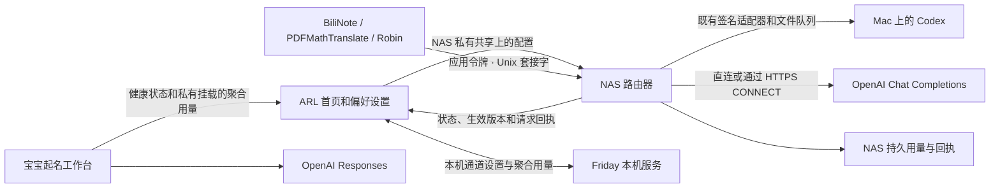

# NAS 应用模型通道

在 ARL 首页「运行概览 → 应用连接」，查看 BiliNote、PDFMathTranslate 和 Robin 的 NAS 接入状态及已生效通道。点应用，在「模型通道」选择仅 Codex、仅 OpenAI API、Codex 优先或 API 优先，再点「保存」。NAS 回读新配置后，详情显示「已生效」，首页随之更新。详情也显示北京时间当天的 API 请求次数、API 已返回的 Token、最近一次路由和请求结果。超时或未返回用量的请求可能没有 Token 回执。

点 Friday 查看本机文字通道和 Friday 自己的 API 账本，也可切换 API、ARL/Codex 或仅本地功能。开启 API 前，在 Friday 的「智能服务」配置 Key。文字通道独立于语音和生图设置。

宝宝起名工作台的详情显示内网在线状态、OpenAI Responses 通道、当天 API 账本、最近成功的模型档位及工作台入口。它继续通过原有 Responses 服务运行。ARL 通过现有私有 NAS 挂载仅读取请求和 Token 的聚合计数、模型标识及档位。

「偏好设置 → NAS 应用模型通道」用于选择控制目录、OpenAI 模型及每日上限。分别关闭全局和单应用的限额开关即可取消 NAS 每日限制，今日请求量仍会记录。已启用的限制按北京时间零点重置，设为 0 可以暂停相应范围的 API 请求。首页保存通道时沿用现有模型和限额。

NAS 应用从 NAS 控制目录发现。「NAS 已接入」表示路由器已确认当前策略且有该应用的请求回执。刚加入策略的应用显示「NAS 已配置，待首次请求」。ARL 原生应用通过主 ARL 的握手会话显示连接状态。



NAS 保留最近应用的配置，并在配置文件缺失或格式不合法时继续使用它。ARL 根据路由器回读的配置版本显示生效状态。API 请求在发送前用 SQLite 事务预留次数，进程重启和并发请求共享计数。上游明确拒绝或用量触顶时，可按设置走备用通道。结果未知的请求保留原回执，同一请求 ID 可查询已完成结果。模型响应在 NAS 私有账本保留 24 小时，去重记录保留 30 天。通道状态只含用量、回执状态和配置版本。

### 常见问题

- 显示「等待 NAS 应用」时，首页仍显示 NAS 上一次确认的通道。等待路由器刷新状态即可。
- 显示「NAS 状态暂不可用」时，检查 NAS 共享是否已挂载，并在偏好设置核对所选的 `router/control` 目录。首页会保留该目录上次发现的应用，并在挂载恢复后更新通道状态。

## BiliNote 试点

1. 在既有 NAS 桥接目录下创建仅 NAS 桥接账户可访问的 `router/code`、`router/control`、`router/state` 和 `router/secret`。将本目录 `nas/` 下的 `router.py`、`local_api.py`、`contract.py` 和仓库的 `arl/codex_context.py` 复制到 `router/code`，最后一个文件命名为 `model_context.py`。
2. 将现有 OpenAI Key 通过已授权的私有路径写入 `router/secret/openai`，权限设为 `0600`。仅路由器挂载该文件。Compose、BiliNote 配置和状态回执中均无需写入 Key。
3. 在 `router/control/policy.json` 保存以下结构。使用新的小写 UUID 作为每次发布的 `revision`，初始可以采用仅 Codex。全局及单应用上限均可省略或设为 `null`；隔离验证可将单应用上限设为 1。

```json
{
  "schema": 1,
  "revision": "9487c551-7823-416d-a164-398ec444be2d",
  "global_daily_api_requests": null,
  "apps": {
    "bilinote": {
      "mode": "codex",
      "api_model": "gpt-5-mini",
      "daily_api_requests": null
    }
  }
}
```

4. 使用 [Compose 示例](compose.router.example.yaml) 启动路由器。将镜像固定为 NAS 已安装、经验证可运行 Python 的镜像，确认 UID 和 GID 与既有应用桥接进程一致。路由器需要到官方 OpenAI API 的出站访问。使用已有 ARL 出网服务时，可在只读代码挂载中保存 `openai-egress.json`，内容为 `{"connect":"内网IPv4:端口"}`，也可在容器命令中配置 `--openai-proxy 内网IPv4:端口`。该设置只为官方 API 建立 CONNECT 隧道，TLS 由路由器验证。使用 Mac 出网时，API 通道依赖 Mac 和其本地代理可用。应用通过各自目录内的套接字连接。
5. 备份当前部署的兼容入口。更新 BiliNote 的只读适配器目录中的 `local_api.py`、`contract.py` 和 `model_context.py`，写入 `router-enrolled/bilinote`，然后单独重启 BiliNote。应用的模型地址与令牌继续使用原配置。设置页可以自动发现唯一的 NAS 控制目录，也可手动选择 `router/control`。
6. 确认路由器的状态和用量已回读，再用一段合成字幕验证摘要。先暂停 Mac 上的专用 Codex 桥接，以 API 优先完成第一个摘要。恢复桥接，确认 Codex 模型目录刷新后，用新的请求验证限额回退及摘要内容。
7. 回滚时移除该应用的 `router-enrolled` 标记。需要恢复旧入口时使用第 5 步的备份。切换前处理正在运行的原请求，避免业务层重复提交。

试点验收后，逐个加入 PDFMathTranslate 和 Robin 的挂载、策略与只读注册标记，并分别复查输出格式和原有 Codex 路径。将路由器启动命令的应用列表与策略的应用列表一并更新。Robin 的原有令牌位于其独立服务目录，可将该文件只读挂载到路由器并用 `--robin-token-file` 指定路径。Robin 适配器从自己的只读挂载读取 `router-enrolled/robin`。现有接口支持文本 Chat Completions 和模型列表。
